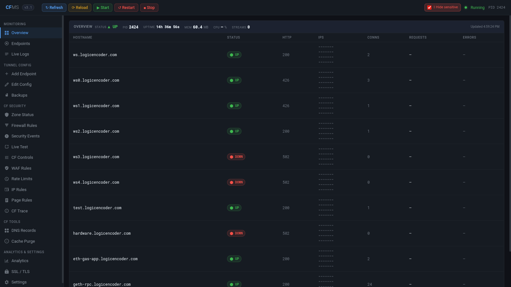

# CFMS — Cloudflare Management System

Keeping a tunneled site available can involve checking tunnels, DNS, security rules and logs in several places. CFMS brings those related tasks into one dashboard so an operator can investigate access problems and maintain the surrounding configuration with less switching.

## Tech stack

| Layer | Technologies |
|---|---|
| Application | Python, FastAPI |
| Supporting technologies | HTML, CSS, JavaScript; Cloudflare; WebSockets |

## Understand tunnel health

The tunnel overview brings endpoint availability, connection activity and resource information into one view. It helps distinguish a problem with a particular hostname from a wider tunnel issue. Open the relevant logs or controls from that context instead of beginning the investigation again elsewhere.

Start with the affected hostname, then compare its state with the rest of the tunnel. The overview gives the investigation a clear scope before the operator changes a setting or restarts a service.

## Maintain endpoints and DNS

Manage the hostnames served by the tunnel and review DNS records alongside them. Editing and backup-oriented controls support routine changes, while visible results help establish whether the intended destination is available. This keeps access maintenance connected to the service being published.

DNS and endpoint configuration are two parts of the same publishing task. Reviewing them together helps the operator keep a public hostname aligned with the service it is meant to expose.

## Review security and access

Zone security views bring firewall rules, managed protection options and recent security events together. WordPress-oriented controls support common site administration needs. Access tests help check how a change affects the destinations and request types being examined.

Security events provide context for a reported access problem. The operator can review the relevant rule and the observed request behaviour within the same workspace.

## Inspect traffic, caching and TLS

Traffic summaries provide context for the site's activity, while cache and TLS controls support routine operation. Purge selected content when a publishing change needs to become visible, or review connection settings during an access issue. These tasks remain part of the same operational workspace.

These controls also serve everyday publishing: refresh cached content after a release, inspect traffic around a change and keep the site's connection preferences visible during troubleshooting.

## Follow the effect of a change

Live logs and connection indicators make the outcome of an operation easier to inspect. Service controls are available when the tunnel itself needs intervention, and sensitive-information masking helps during demonstrations. The aim is a shorter path from a reported problem to an informed action.

The dashboard supports a complete operational loop: notice an issue, inspect the associated information, make the intended change and review the resulting state.

---

Private code: [cfms](https://github.com/logicencoder/cfms)

See [REPOS.md](REPOS.md) for related repositories.

**[Logic Encoder](https://logicencoder.com)** · [GitHub](https://github.com/logicencoder) · [Contact](https://logicencoder.com/contact/)
