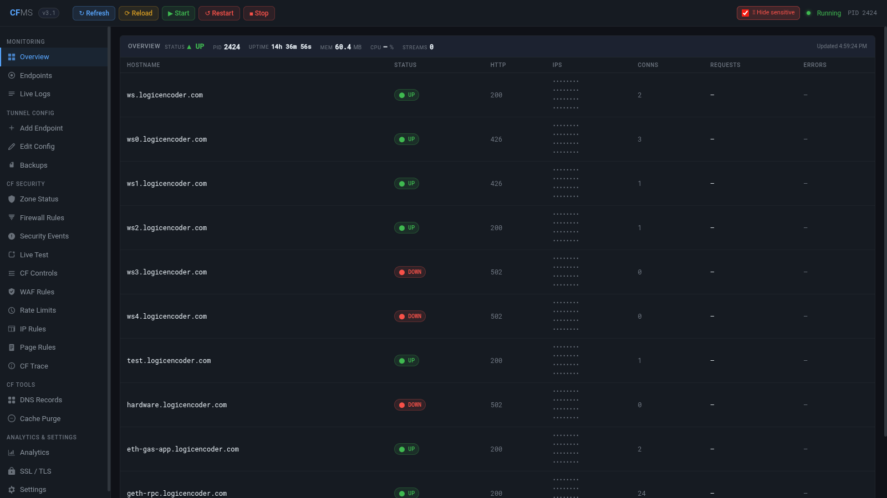

# CFMS — Cloudflare Management System

Keeping a tunneled site available can involve checking tunnels, DNS, security rules and logs in several places. CFMS brings those related tasks into one dashboard so an operator can investigate access problems and maintain the surrounding configuration with less switching.

## Tech stack

| Layer | Technologies |
|---|---|
| Application | Python, FastAPI |
| Supporting technologies | HTML, CSS, JavaScript; Cloudflare; WebSockets |

## Understand tunnel health

The **Overview** lists every hostname the tunnel serves with a live check of whether it answers, together with connection activity and resource figures, so a problem with one hostname is easy to tell apart from a problem with the whole tunnel. **Live Logs** streams the output of the tunnel service next to it.

Start with the affected hostname, then compare its state with the rest of the tunnel. The overview gives the investigation a clear scope before the operator changes a setting or restarts a service.

## Maintain endpoints and DNS

**All Endpoints** lists the hostnames and the local services behind them; **Add Endpoint** adds one, a **YAML Preview** shows exactly what will be written, **Edit Config** edits the raw tunnel configuration and **Config Backups** lists the timestamped copies the dashboard makes before it writes the configuration (a **Backup Now** button makes one on demand). The **DNS Records** screen lists the zone's records and adds, edits and deletes them, so a hostname and its record are maintained in one place.

DNS and endpoint configuration are two parts of the same publishing task. Reviewing them together helps the operator keep a public hostname aligned with the service it is meant to expose.

## Review security and access

**CF Zone Status** summarises the zone's protection settings. Rules are shown by type: custom ruleset rules, legacy firewall rules, WAF managed rules, rate-limiting rules, IP access rules and page rules. **Security Events** lists recent events with the action taken (block, allow, challenge or skip), and **Live Access Test** sends test requests with chosen browser and bot identities to a hostname and shows how each is treated. WordPress-oriented controls switch Bot Management JavaScript on or off, apply or remove a WP hardening rule set and patch a bypass rule, and **CF Trace** explains how a request is processed.

Security events provide context for a reported access problem. The operator can review the relevant rule and the observed request behaviour within the same workspace.

## Inspect traffic, caching and TLS

**Traffic Analytics** summarises requests for the zone. **Purge Everything** (after a confirmation) and **Purge Specific URLs** make a publishing change visible, and **SSL / TLS Settings** shows and changes the zone's connection settings.

These controls also serve everyday publishing: refresh cached content after a release, inspect traffic around a change and keep the site's connection preferences visible during troubleshooting.

## Follow the effect of a change

Start, stop, restart and reload buttons control the tunnel service, and results appear in the log and on the Overview. **App Configuration** and **Cloudflare Credentials** hold the dashboard's own settings, and **Screenshot Protection** hides sensitive values during demonstrations.

The dashboard supports a complete operational loop: notice an issue, inspect the associated information, make the intended change and review the resulting state.

---

Private code: [cfms](https://github.com/logicencoder/cfms)

See [REPOS.md](REPOS.md) for related repositories.

**[Logic Encoder](https://logicencoder.com)** · [GitHub](https://github.com/logicencoder) · [Contact](https://logicencoder.com/contact/)
